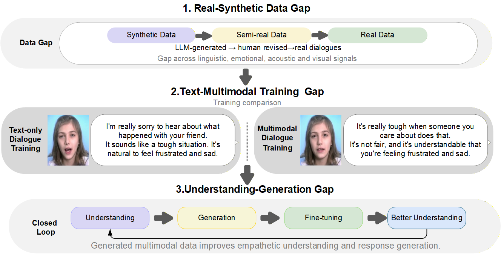

<div align="center">

# PsyMM

### From Text to Omni-Modal: Bridging the Gap in Psychological Support Dialogue

**A bilingual pipeline for aligned text, speech and talking-head psychological support dialogues**

[](LICENSE)


[Overview](#overview) · [Run the pipeline](#run-the-pipeline) · [Repository guide](#repository-guide) · [Data and models](#data-and-models) · [Related projects](#related-projects)

</div>

<a id="overview"></a>
## 📖 Overview

PsyMM converts six psychological support dialogue sources into aligned text, synthesized speech and talking-head video for omni-modal research. The pipeline records source provenance, paired identity references, intended emotion, media checksums and resumable generation state.



<div align="center"><sub>Research gaps illustrated in the paper.</sub></div>

The seeker and supporter receive distinct identities that stay fixed **within one dialogue**. A new dialogue can use a different pair. Non-neutral speech uses a reference from the selected identity's AvaMERG emotion pool; neutral speech uses the base TTS expression with identity conversion. DICE-Talk uses the generated audio, the paired portrait and an intended emotion prior. Perceived emotion and media quality require independent evaluation; the control labels alone do not establish them.

## 📦 Availability

| Resource | This repository |
| :-- | :-- |
| Generation, preflight and audit code | Included |
| Component source integrations | Included; see [upstream terms](#license-and-attribution) |
| Dialogue corpus and reference media | Not included |
| Model checkpoints and other runtime assets | Not included |
| Public dataset download | In preparation   |

The paper's aggregate dataset counts are research results, not a claim that those files can currently be downloaded from this repository.
<a id="run-the-pipeline"></a>
## 🚀 Run the pipeline

Generation requires Linux and Python 3.10+. `--help` and the CPU contract tests do not load model weights:

```bash
python generate_multimodal.py --help
python -m unittest discover -s tests -q
```

For generation, provide authorized dialogue inputs, AvaMERG references, compatible Python environments, `ffmpeg`/`ffprobe` and the required model assets. Paths are explicit and portable:

| Variable | Default | Points to |
| :-- | :-- | :-- |
| `PSYMM_ROOT` | Repository root | Source code and run-related files |
| `PSYMM_DATA` | `$PSYMM_ROOT/data` | Authorized source and AvaMERG files |
| `PSYMM_WEIGHTS` | `$PSYMM_ROOT/weights` | Component checkpoints |
| `PSYMM_AUDIO_PYTHON` | `python` on `PATH` | Python with MeloTTS and OpenVoice dependencies |
| `PSYMM_VIDEO_PYTHON` | `python` on `PATH` | Python with DICE-Talk dependencies |

An example with two source records:

```bash
export PSYMM_ROOT="$PWD"
export PSYMM_DATA="/path/to/authorized/data"
export PSYMM_WEIGHTS="/path/to/authorized/weights"
export PSYMM_AUDIO_PYTHON="/path/to/audio-env/bin/python"
export PSYMM_VIDEO_PYTHON="/path/to/video-env/bin/python"

bash run_multimodal.sh prepare \
  --source extes \
  --input "/path/to/source.json" \
  --catalog "$PSYMM_DATA/AvaMERG/train.json" \
  --run "/path/to/pilot-run" --limit 2

bash run_multimodal.sh audio --run "/path/to/pilot-run" --gpu 0
bash run_multimodal.sh video --run "/path/to/pilot-run" --gpu 0
bash run_multimodal.sh validate --run "/path/to/pilot-run"
bash run_multimodal.sh export --run "/path/to/pilot-run"
```

Use `--gpu` only for an allocated device. The stages are resumable; `validate` and `export` check recorded assets and produce `multimodal_manifest.json`. The manifest contains local paths and is **not** a public dataset package. See [environment and paths](docs/ENVIRONMENT.md) before a full run.

`psyqa_identity.py` is called automatically for the supported sources. It checks that the seeker and supporter retain distinct identities within a dialogue and that their audio and portrait references agree. These metadata checks do not measure perceived face or voice similarity.

<a id="repository-guide"></a>
## 🛠️ Repository guide

| Path | Role |
| :-- | :-- |
| [`generate_multimodal.py`](generate_multimodal.py), [`psymm_generation/`](psymm_generation/) | Normalize, plan, synthesize, validate and export |
| [`psyqa_identity.py`](psyqa_identity.py) | Automatically check fixed role identities and paired audio/image references for PsyQA, PsyDial and ExTES |
| [`experiments/`](experiments/) | Data provenance audits, emotion annotation validation and audio/video quality evaluation |
| [`tests/`](tests/) | CPU contracts and optional media integration tests |
| `MeloTTS-main/`, `OpenVoice-main/`, `DICE-Talk-main/` | Adapted component source snapshots |

<a id="data-and-models"></a>
## 📊 Data and models

The manuscript draws on ESConv, ExTES, OpenR1-Psy and Psych8k in English, and PsyDial and PsyQA in Chinese. Each source and reference collection needs its own redistribution and privacy review. Synthetic speech and video are generated media, not direct observations of a real person's psychological state. This resource supports research and is not a clinical diagnostic or emergency service.

See the [draft dataset card](docs/DATASET_CARD_DRAFT.md) and [release checklist](docs/RELEASE_CHECKLIST.md) for the publication steps and remaining checks.

<a id="related-projects"></a>
## 🔗 Related projects

- [E3RG](https://github.com/RH-Lin/E3RG): the related multimodal empathetic response generation framework discussed in the paper.
- [MeloTTS](https://github.com/myshell-ai/MeloTTS) and [OpenVoice](https://github.com/myshell-ai/OpenVoice): speech synthesis and voice conversion.
- [DICE-Talk](https://github.com/toto222/DICE-Talk): emotion-aware talking-head video generation.

<a id="license-and-attribution"></a>
## 📄 License and attribution

Project-owned code is provided under [Apache-2.0](LICENSE). Bundled component source has separate terms: [OpenVoice](OpenVoice-main/LICENSE) and [MeloTTS](MeloTTS-main/LICENSE) use MIT; [DICE-Talk](DICE-Talk-main/LICENSE) uses CC BY-NC-SA 4.0. See [third-party source notices](THIRD_PARTY_NOTICES.md). These licenses do not grant rights to source datasets, reference media or model weights.
